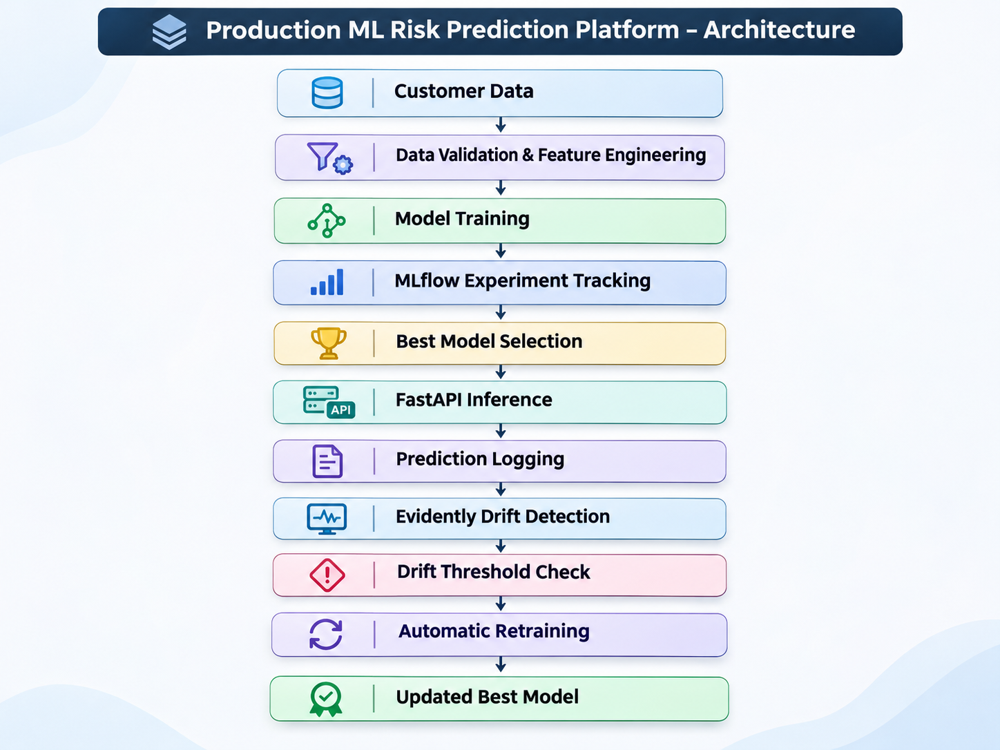
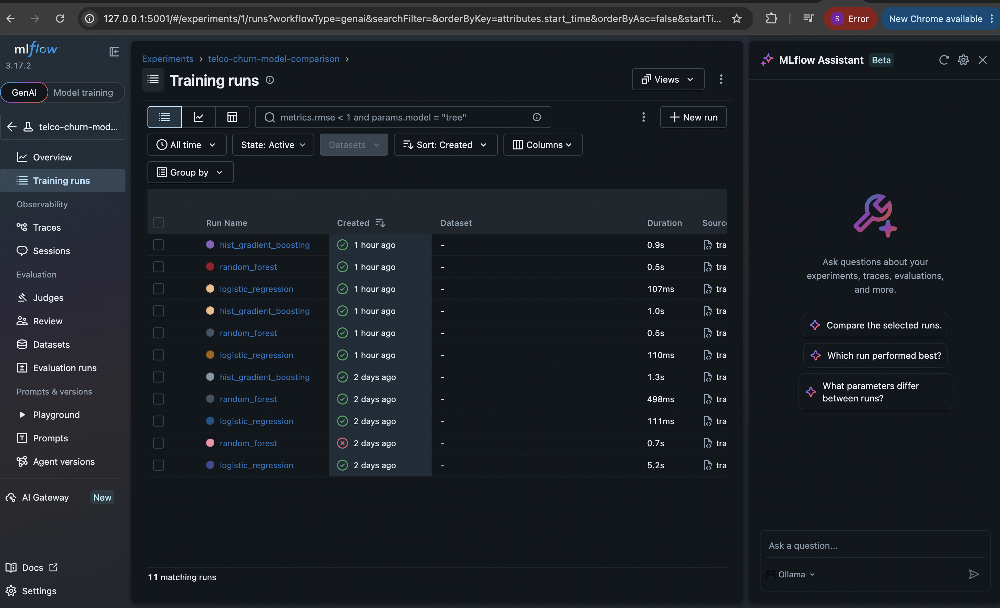
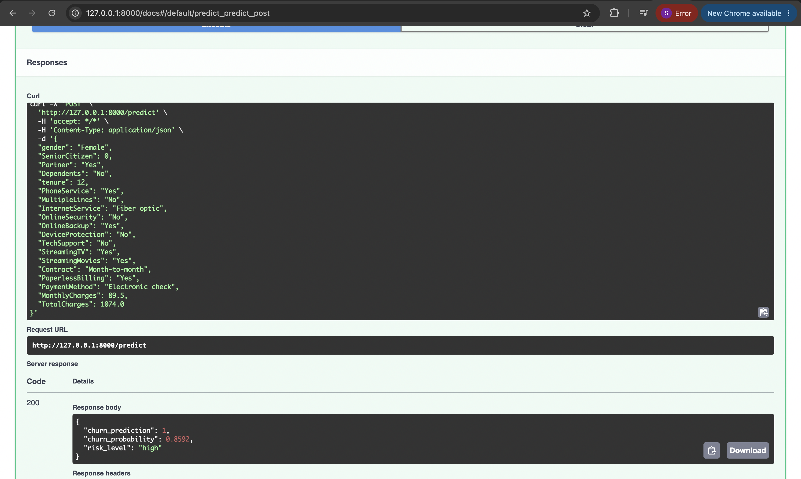
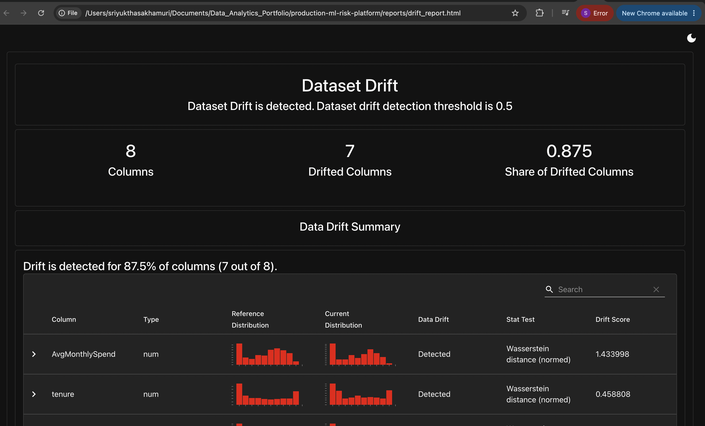
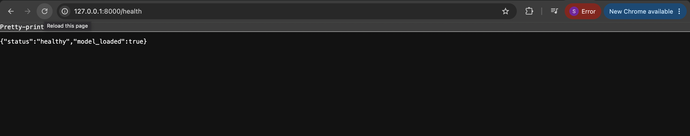
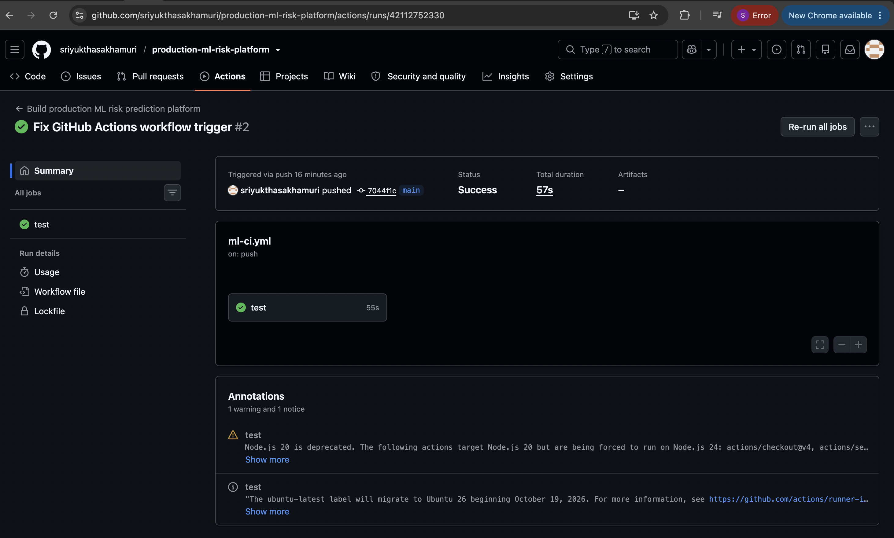

# Production ML Risk Prediction & Monitoring Platform

An end-to-end machine learning and MLOps platform for predicting customer churn risk, tracking experiments, serving real-time predictions, monitoring production data drift, and automatically triggering model retraining when drift exceeds a configured threshold.

The project demonstrates the full ML lifecycle:

**Data → Feature Engineering → Model Training → Experiment Tracking → Model Serving → Prediction Logging → Drift Detection → Automated Retraining → CI/CD**

---

## Project Overview

Production machine learning systems require more than training a model once.

A deployed model must be:

- reproducible
- measurable
- accessible through an API
- monitored for changing data distributions
- tested automatically
- containerized for consistent deployment
- retrained when production conditions change

This project implements those capabilities around a **customer churn prediction problem** using the IBM Telco Customer Churn dataset.

Three classification models are trained and compared:

- Logistic Regression
- Random Forest
- HistGradientBoosting

Experiments are tracked with **MLflow**, the selected model is served through **FastAPI**, prediction requests are logged, and **Evidently** monitors feature distributions for drift.

When drift exceeds the configured threshold, the platform automatically launches the model training workflow again and records the retraining event.

---

## Architecture

```text
                         ┌─────────────────────┐
                         │  Customer Dataset   │
                         └──────────┬──────────┘
                                    │
                                    ▼
                         ┌─────────────────────┐
                         │ Data Validation &   │
                         │ Feature Engineering │
                         └──────────┬──────────┘
                                    │
                                    ▼
                    ┌───────────────────────────────┐
                    │       Model Training          │
                    │                               │
                    │  Logistic Regression          │
                    │  Random Forest                │
                    │  HistGradientBoosting         │
                    └───────────────┬───────────────┘
                                    │
                                    ▼
                         ┌─────────────────────┐
                         │       MLflow        │
                         │ Experiment Tracking │
                         └──────────┬──────────┘
                                    │
                                    ▼
                         ┌─────────────────────┐
                         │   Best ML Model     │
                         └──────────┬──────────┘
                                    │
                                    ▼
                         ┌─────────────────────┐
                         │      FastAPI        │
                         │   /predict API      │
                         └──────────┬──────────┘
                                    │
                         ┌──────────┴──────────┐
                         ▼                     ▼
              ┌─────────────────┐    ┌─────────────────┐
              │ Prediction Log  │    │ API Response    │
              └────────┬────────┘    └─────────────────┘
                       │
                       ▼
              ┌─────────────────┐
              │    Evidently    │
              │ Drift Detection │
              └────────┬────────┘
                       │
                       ▼
              ┌─────────────────┐
              │ Drift Threshold │
              │      Check      │
              └────────┬────────┘
                       │
                  Drift >= 50%
                       │
                       ▼
              ┌─────────────────┐
              │ Auto Retraining │
              └────────┬────────┘
                       │
                       ▼
              ┌─────────────────┐
              │ Retraining Log  │
              └─────────────────┘
```

---

## Tech Stack

### Machine Learning

- Python
- pandas
- NumPy
- scikit-learn
- Logistic Regression
- Random Forest
- HistGradientBoosting

### MLOps

- MLflow
- Evidently
- joblib
- automated drift monitoring
- automated retraining workflow

### API & Serving

- FastAPI
- Pydantic
- Uvicorn

### Testing & DevOps

- pytest
- Docker
- GitHub Actions
- Git

---

## Dataset

The project uses the **IBM Telco Customer Churn dataset**.

The original dataset contains approximately:

- **7,043 customer records**
- **21 source columns**
- churn target: `Yes` / `No`

After preprocessing invalid `TotalCharges` values, the training dataset contains:

- **7,032 rows**

The churn target distribution after cleaning is:

```text
Non-Churn: 5,163
Churn:     1,869
```

Because the target is imbalanced, the project evaluates models using several metrics instead of relying only on accuracy.

---

## Feature Engineering

The preprocessing pipeline:

- converts `TotalCharges` to numeric
- removes invalid missing `TotalCharges` records
- converts `Churn` into binary values
- removes `customerID`
- separates numerical and categorical features
- scales numerical features
- one-hot encodes categorical features
- creates the engineered feature:

```text
AvgMonthlySpend = TotalCharges / tenure
```

This preprocessing logic is included directly inside the model pipeline so inference uses the same transformations as training.

---

## Model Training

Three models are trained using a stratified train/test split:

### Logistic Regression

Uses:

```text
class_weight="balanced"
```

to help handle class imbalance.

### Random Forest

Configured with:

- 300 estimators
- controlled tree depth
- balanced class weights
- parallel execution

### HistGradientBoosting

Uses gradient-boosted decision trees implemented directly in scikit-learn.

---

## Model Evaluation

The models are evaluated using:

- Accuracy
- Precision
- Recall
- F1 Score
- ROC-AUC

The current best model on the project's test split is:

```text
Model:   Logistic Regression
ROC-AUC: 0.8354
```

The selected model is automatically saved to:

```text
app/models/artifacts/best_model.joblib
```

Model comparison results are stored in:

```text
app/models/artifacts/model_comparison.csv
app/models/artifacts/mlflow_model_comparison.csv
```

---

## MLflow Experiment Tracking

MLflow tracks model experiments including:

- model type
- model parameters
- accuracy
- precision
- recall
- F1
- ROC-AUC
- model artifacts

Experiment name:

```text
telco-churn-model-comparison
```

### MLflow Training Runs



The experiment contains successful runs for:

- Logistic Regression
- Random Forest
- HistGradientBoosting

This makes model selection reproducible rather than relying on manually recorded results.

---

## Real-Time Prediction API

The selected model is exposed through a FastAPI service.

Available endpoints:

```text
GET  /
GET  /health
POST /predict
```

### Example Prediction Request

```json
{
  "gender": "Female",
  "SeniorCitizen": 0,
  "Partner": "Yes",
  "Dependents": "No",
  "tenure": 12,
  "PhoneService": "Yes",
  "MultipleLines": "No",
  "InternetService": "Fiber optic",
  "OnlineSecurity": "No",
  "OnlineBackup": "Yes",
  "DeviceProtection": "No",
  "TechSupport": "No",
  "StreamingTV": "Yes",
  "StreamingMovies": "Yes",
  "Contract": "Month-to-month",
  "PaperlessBilling": "Yes",
  "PaymentMethod": "Electronic check",
  "MonthlyCharges": 89.5,
  "TotalCharges": 1074.0
}
```

### Example Response

```json
{
  "churn_prediction": 1,
  "churn_probability": 0.8592,
  "risk_level": "high"
}
```

Risk levels are categorized as:

```text
Probability < 0.40        → Low
0.40 <= Probability < .70 → Medium
Probability >= 0.70       → High
```

### FastAPI Prediction



---

## Prediction Logging

Every prediction request is logged for monitoring.

The log contains:

- timestamp
- input features
- churn prediction
- churn probability
- risk level

Prediction logs are written to:

```text
reports/predictions.csv
```

This creates a production-style data trail that can later be used for monitoring and model analysis.

---

## Data Drift Monitoring

Production ML systems can degrade when the distribution of incoming data changes.

The project uses **Evidently** to compare production-like data against the original training baseline.

Monitored features include:

```text
SeniorCitizen
tenure
MonthlyCharges
TotalCharges
AvgMonthlySpend
Contract
InternetService
PaymentMethod
```

A controlled synthetic production batch was generated with intentional shifts such as:

- increased monthly charges
- reduced customer tenure
- increased month-to-month contracts
- increased fiber-optic customers
- increased electronic-check usage

This batch is used to validate that the monitoring system can detect meaningful distribution shifts.

### Drift Test Result

For the controlled synthetic drift scenario:

```text
Monitored columns:      8
Drifted columns:        7
Share of drifted data:  87.5%
Drift threshold:        50%
Dataset drift:          Detected
```

> The 87.5% result represents an intentionally shifted synthetic validation scenario designed to test the monitoring pipeline. It is not a claim about real production customer traffic.

### Evidently Drift Report



---

## Automatic Retraining

The platform implements a closed-loop retraining workflow.

The retraining logic is:

```text
Generate / receive production data
            ↓
Run drift analysis
            ↓
Calculate drifted feature share
            ↓
Compare against threshold
            ↓
If drift >= 50%
            ↓
Trigger model training pipeline
            ↓
Run all candidate models
            ↓
Track new experiments in MLflow
            ↓
Select best model
            ↓
Save updated model artifact
```

During the drift validation scenario:

```text
Detected drift:       87.5%
Retraining threshold: 50%
Result:               Retraining triggered
Best model:           Logistic Regression
Best ROC-AUC:         0.8354
```

Retraining events are logged to:

```text
reports/retraining_events.csv
```

Each event records:

- UTC timestamp
- measured drift share
- configured threshold
- whether retraining occurred
- selected best model
- best ROC-AUC

---

## Dockerized Model Serving

The API is packaged in Docker so the inference environment can be reproduced consistently.

Build the image:

```bash
docker build -t production-ml-risk-platform .
```

Run the container:

```bash
docker run --rm -p 8000:8000 production-ml-risk-platform
```

Then open:

```text
http://127.0.0.1:8000/docs
```

Health endpoint:

```text
http://127.0.0.1:8000/health
```

Expected response:

```json
{
  "status": "healthy",
  "model_loaded": true
}
```

### Docker Health Check



---

## Automated Testing

The project includes automated tests for both the API and ML pipeline.

### API Tests

Tests verify:

- `/health` responds successfully
- model is loaded
- `/predict` accepts valid customer input
- predictions are binary
- probabilities stay between 0 and 1
- risk levels are valid

### ML Pipeline Tests

Tests verify:

- preprocessing completes successfully
- required engineered features exist
- missing values are removed
- model artifact exists
- saved model can be loaded
- target values remain binary

Run locally:

```bash
python -m pytest -v
```

Current test result:

```text
6 passed
```

---

## GitHub Actions CI

A GitHub Actions workflow automatically runs the test suite on:

- pushes to `main`
- pull requests targeting `main`

CI workflow:

```text
Checkout repository
       ↓
Set up Python
       ↓
Install dependencies
       ↓
Run pytest
       ↓
Pass / Fail build
```

Workflow file:

```text
.github/workflows/ml-ci.yml
```

### Successful CI Run



---

## Project Structure

```text
production-ml-risk-platform/
│
├── .github/
│   └── workflows/
│       └── ml-ci.yml
│
├── app/
│   ├── api/
│   │   └── main.py
│   │
│   ├── core/
│   │   ├── data_loader.py
│   │   └── preprocess.py
│   │
│   ├── models/
│   │   ├── train.py
│   │   ├── train_mlflow.py
│   │   └── artifacts/
│   │       ├── best_model.joblib
│   │       ├── model_comparison.csv
│   │       └── mlflow_model_comparison.csv
│   │
│   └── services/
│       ├── prediction_logger.py
│       ├── drift_monitor.py
│       ├── generate_production_traffic.py
│       └── retraining_trigger.py
│
├── data/
│   ├── raw/
│   │   └── telco_customer_churn.csv
│   └── processed/
│       └── telco_customer_churn_clean.csv
│
├── docs/
│   ├── evidently-drift-report.png
│   ├── fastapi-prediction.png
│   ├── ml-risk-docker-health-check.png
│   ├── ml-risk-github-actions-success.png
│   └── mlflow-model-comparison.png
│
├── reports/
│
├── tests/
│   ├── test_api.py
│   └── test_pipeline.py
│
├── .dockerignore
├── .gitignore
├── Dockerfile
├── README.md
└── requirements.txt
```

---

## Running the Project Locally

### 1. Clone the repository

```bash
git clone https://github.com/sriyukthasakhamuri/production-ml-risk-platform.git
cd production-ml-risk-platform
```

### 2. Create a virtual environment

```bash
python3 -m venv .venv
source .venv/bin/activate
```

### 3. Install dependencies

```bash
python -m pip install --upgrade pip
pip install -r requirements.txt
```

### 4. Run preprocessing

```bash
python -m app.core.preprocess
```

### 5. Train models

```bash
python -m app.models.train
```

### 6. Train with MLflow tracking

```bash
python -m app.models.train_mlflow
```

### 7. Start MLflow

```bash
mlflow ui --host 127.0.0.1 --port 5001 --allowed-hosts "*"
```

Open:

```text
http://127.0.0.1:5001
```

### 8. Start FastAPI

```bash
uvicorn app.api.main:app --reload --port 8000
```

Open:

```text
http://127.0.0.1:8000/docs
```

### 9. Generate production-like drift data

```bash
python -m app.services.generate_production_traffic
```

### 10. Generate drift report

```bash
python -m app.services.drift_monitor
```

Open the report on macOS:

```bash
open reports/drift_report.html
```

### 11. Run automatic retraining check

```bash
python -m app.services.retraining_trigger
```

### 12. Run tests

```bash
python -m pytest -v
```

---

## Key Engineering Outcomes

This project demonstrates:

- end-to-end supervised machine learning
- categorical and numerical preprocessing
- feature engineering
- class-imbalance-aware modeling
- multi-model benchmarking
- ROC-AUC-based model selection
- experiment tracking with MLflow
- serialized production model artifacts
- REST model serving with FastAPI
- prediction probability and risk classification
- production prediction logging
- feature distribution monitoring
- controlled data drift simulation
- Evidently-based drift detection
- threshold-based automatic retraining
- retraining audit logging
- Dockerized inference
- automated testing
- GitHub Actions CI

---

## Measured Results

| Metric | Result |
|---|---:|
| Best model | Logistic Regression |
| Best ROC-AUC | **0.8354** |
| Models compared | **3** |
| Automated tests | **6 passing** |
| Monitored drift features | **8** |
| Drifted features in controlled scenario | **7 / 8** |
| Drift share in controlled scenario | **87.5%** |
| Retraining trigger threshold | **50%** |
| CI status | **Passing** |
| Docker health check | **Healthy** |

---

## Future Improvements

Possible extensions include:

- model registry promotion stages
- PostgreSQL-backed prediction logging
- model performance monitoring once ground-truth labels arrive
- scheduled drift monitoring
- retraining approval gates
- Kubernetes deployment
- Prometheus and Grafana monitoring
- cloud deployment on AWS or GCP
- feature store integration
- CI-based Docker image builds
- champion/challenger model promotion

---

## Repository

GitHub:

https://github.com/sriyukthasakhamuri/production-ml-risk-platform

---

## Author

**Sriyuktha Sakhamuri**

AI & Analytics Engineer

GitHub: https://github.com/sriyukthasakhamuri